<div align="center">

# ScholarScope
### A distributed search engine for 2.5 million research papers

**C++17 · OpenMP · MPI · Docker · AWS EC2** — CSC334 Parallel & Distributed Computing, Assignment 1 (COMSATS, Fall 2026)

<picture>
  <source media="(prefers-color-scheme: dark)" srcset="Images/charts/race-dark.gif">
  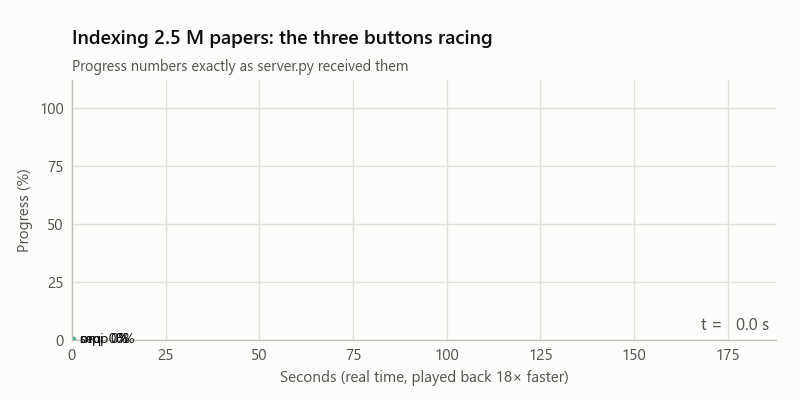
</picture>

| 📚 Corpus | ⚡ Fastest build | 🎯 Correctness | 🧠 Peak memory |
|:---:|:---:|:---:|:---:|
| **2,514,698** papers | **8.3×** faster<br/>185 s → 22 s | **39 / 39** runs give<br/>identical top-10 | **7.8 GB** on one node<br/>**3.0 GB** on the master in the cluster |

</div>

One C++ binary builds a TF-IDF index over words **and word pairs** and returns the top-10 papers for a query.
A provided web page runs it three ways and times each run itself:

| Button | What runs | Parallelism | Memory |
|---|---|---|---|
| **1. Sequential** | `engine index …` | 1 process · 1 thread | — |
| **2. Single machine** | same, `OMP_NUM_THREADS=T` | 1 process · T threads | shared |
| **3. Cluster** | `mpirun -np P … engine index …` | P processes on 3 machines · T threads | distributed |

> ⚠️ Every student has different shards and settings — the engine reads *your* `settings.txt`, the scripts read *your*
> `config.json`. Learn from this repo; write and understand your own submission.

**Contents:** [1 Results](#1-results) · [2 Architecture](#2-architecture) · [3 The maths](#3-the-maths-in-60-seconds) ·
[4 Repository](#4-repository-layout) · [5 Step-by-step guide](#5-step-by-step-guide) · [6 Reproduce](#6-reproduce-the-benchmarks) ·
[7 Troubleshooting](#7-troubleshooting) · [8 Grading checklist](#8-grading-checklist)

---

## 1. Results

Measured by the provided `server.py` on **3 × AWS m5.xlarge** (4 vCPU = 2 physical cores with hyper-threading, 16 GB).
Every chart is generated by `make_charts.py` from `results/` — no number is typed in by hand.

### Build time vs data size

<p align="center"><picture>
  <source media="(prefers-color-scheme: dark)" srcset="Images/charts/time-vs-size-dark.svg">
  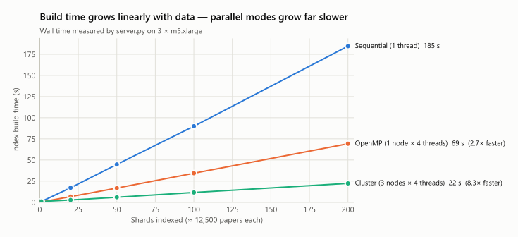
</picture></p>

> **What it shows:** how long each mode needs to index 1 → 200 shards.<br/>
> **Look for:** three straight lines — work grows linearly with data, and each parallel mode has a far flatter slope.<br/>
> **Wow:** the full 2.5 M papers take **3 min** on one core but **22 s** on the cluster.

<details><summary>Data table</summary>

| Shards | Sequential | OpenMP 1×4 | Cluster 3×4 | OpenMP speedup | Cluster speedup |
|---:|---:|---:|---:|---:|---:|
| 1 | 0.83 s | 0.39 s | 0.89 s | 2.1× | 0.9× |
| 20 | 17.15 s | 6.63 s | 2.66 s | 2.6× | 6.4× |
| 50 | 44.73 s | 16.78 s | 5.93 s | 2.7× | 7.5× |
| 100 | 89.91 s | 34.37 s | 11.56 s | 2.6× | 7.8× |
| 200 | 184.59 s | 69.21 s | 22.32 s | 2.7× | 8.3× |
</details>

### Speedup on the full dataset

<p align="center"><picture>
  <source media="(prefers-color-scheme: dark)" srcset="Images/charts/speedup-L-dark.svg">
  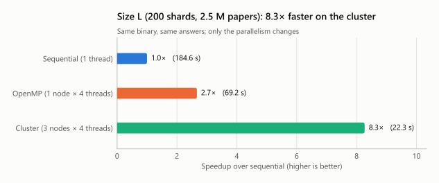
</picture></p>

> **What it shows:** speedup over sequential for the 200-shard run.<br/>
> **Look for:** the cluster bar is ~3× the OpenMP bar — three machines give three times one machine.<br/>
> **Wow:** that is **103 % scaling efficiency** across machines: each node sorts only a third of the data, so it runs slightly better than ideal.

### OpenMP threads on one machine

<p align="center"><picture>
  <source media="(prefers-color-scheme: dark)" srcset="Images/charts/thread-scaling-dark.svg">
  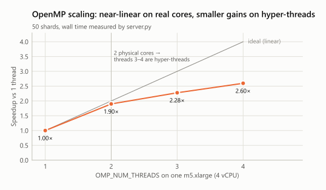
</picture></p>

> **What it shows:** speedup as `OMP_NUM_THREADS` goes from 1 to 4 on one 4-vCPU node.<br/>
> **Look for:** the curve hugs the ideal line up to 2 threads, then bends.<br/>
> **Wow:** the bend is the hardware — 4 vCPUs are only **2 real cores**; threads 3–4 are hyper-threads sharing them.

<details><summary>Data table</summary>

| Threads | Wall | Speedup | Efficiency |
|---:|---:|---:|---:|
| 1 | 44.10 s | 1.00× | 100 % |
| 2 | 23.22 s | 1.90× | 95 % |
| 3 | 19.37 s | 2.28× | 76 % |
| 4 | 16.98 s | 2.60× | 65 % |
</details>

### Cluster layouts — and a bug the benchmark found

<p align="center"><picture>
  <source media="(prefers-color-scheme: dark)" srcset="Images/charts/layouts-dark.svg">
  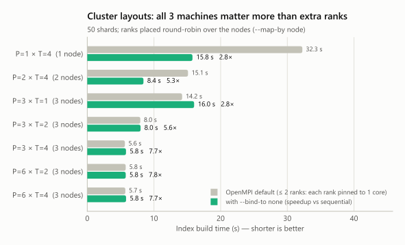
</picture></p>

> **What it shows:** build time for each P ranks × T threads layout, before (grey) and after (green) one mpirun flag.<br/>
> **Look for:** the top two rows — with ≤ 2 ranks, OpenMPI pinned each rank to **one core**, so its 4 threads queued on it.<br/>
> **Wow:** adding `--bind-to none` made those runs **2× faster**; everything else stayed the same — and the answers stayed identical.

<details><summary>Data table (50 shards; sequential 44.73 s)</summary>

| Layout | Machines | Default binding | `--bind-to none` | Speedup (after) |
|---|---:|---:|---:|---:|
| P=1 × T=4 | 1 | 32.25 s | 15.78 s | 2.8× |
| P=2 × T=4 | 2 | 15.11 s | 8.43 s | 5.3× |
| P=3 × T=1 | 3 | 14.22 s | 16.02 s | 2.8× |
| P=3 × T=2 | 3 | 7.95 s | 7.99 s | 5.6× |
| P=3 × T=4 | 3 | 5.64 s | 5.81 s | 7.7× |
| P=6 × T=2 | 3 | 5.76 s | 5.77 s | 7.8× |
| P=6 × T=4 | 3 | 5.71 s | 5.82 s | 7.7× |
</details>

### Where the time goes

<p align="center"><picture>
  <source media="(prefers-color-scheme: dark)" srcset="Images/charts/phases-L-dark.svg">
  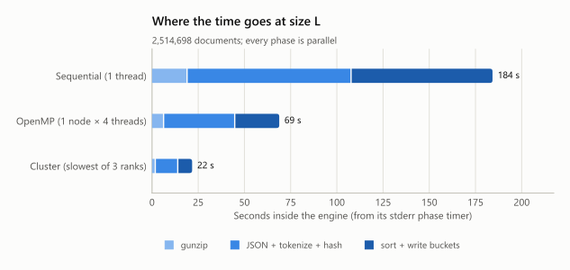
</picture></p>

> **What it shows:** the engine's own timer for its three phases at 200 shards.<br/>
> **Look for:** every segment shrinks in every mode — no phase is left serial.<br/>
> **Wow:** sorting ~420 M postings is **a third of the work**; it is parallel too (256 independent buckets).

### Memory while indexing 2.5 M papers

<p align="center"><picture>
  <source media="(prefers-color-scheme: dark)" srcset="Images/charts/memory-L-dark.svg">
  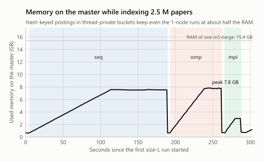
</picture></p>

> **What it shows:** used RAM on the master, sampled every second, across the three 200-shard runs.<br/>
> **Look for:** a ramp while postings pile up, a plateau while they are sorted, a drop when the index is written.<br/>
> **Wow:** distributed memory is *divided* memory — in the cluster the master needs only **3.0 GB** instead of 7.8 GB.

### Nine lessons from the numbers

| # | Lesson | Evidence |
|---|---|---|
| 1 | Machines scale almost perfectly | cluster ÷ OpenMP = **3.1×** with 3× the machines |
| 2 | A vCPU is not a core | 1→2 threads 1.90×, 2→4 threads only +37 % |
| 3 | Amdahl's law is real | serial gunzip capped 4 threads at 2.1×; decompressing files in parallel raised it to 3.2× (laptop) |
| 4 | Small jobs don't deserve a cluster | 1 shard: cluster 0.89 s vs sequential 0.83 s (mpirun + ssh start-up ≈ 0.5 s) |
| 5 | Distribution costs latency | search: 15–33 ms on one node vs ~530 ms on the cluster |
| 6 | Defaults can halve your speed | `--bind-to none` made 1–2-rank runs 2× faster |
| 7 | Distributed memory is divided memory | 7.8 GB on one node vs 3.0 GB on the master in the cluster |
| 8 | Determinism is designable | 39 runs: identical top-10 in every mode, thread count, layout and binding |
| 9 | It is repeatable | three size-M runs per mode agree within ± 3 % |

### The live system

<table>
<tr><td align="center"><b>The page (server.py, unchanged)</b></td><td align="center"><b>Run history with speedups</b></td></tr>
<tr><td>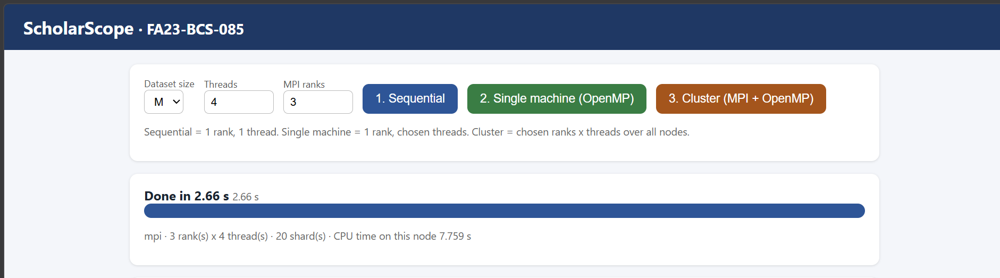</td><td>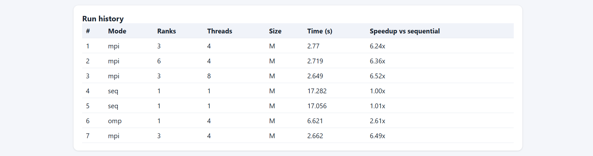</td></tr>
<tr><td align="center"><b>Searching the index</b></td><td align="center"><b>Engine vs answer key (check.py)</b></td></tr>
<tr><td>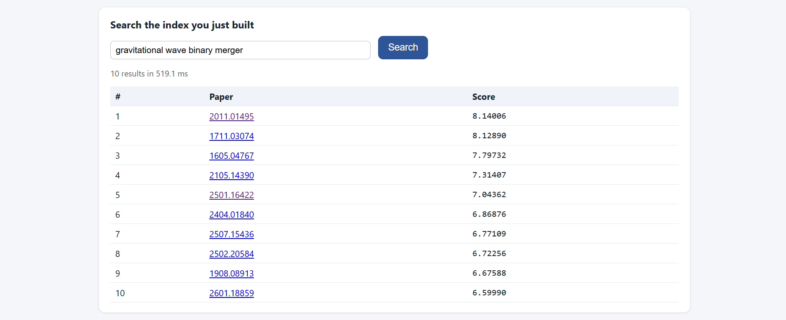</td><td>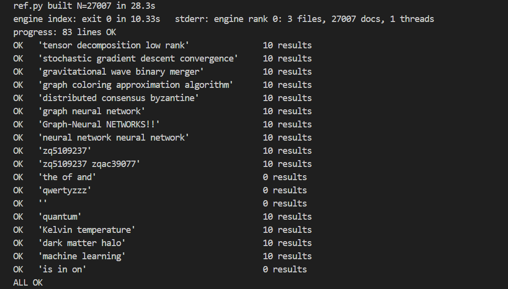</td></tr>
</table>

---

## 2. Architecture

### 2.1 Deployment

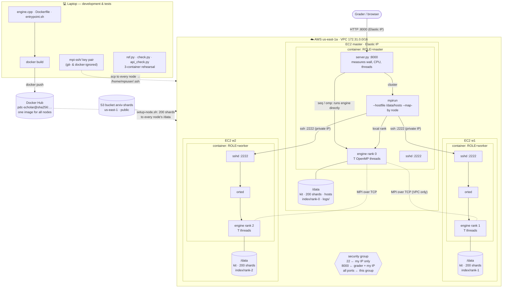

| Piece | Where | Role |
|---|---|---|
| `server.py` | master, :8000 | given; serves the page, launches the engine, measures everything independently |
| `/opt/engine` | every container | `index` and `search` |
| `sshd` :2222 | every container | how mpirun starts remote ranks; keys only, user `mpiuser` |
| `/data` | each node's own disk | kit, 200 shards, that node's part of the index, logs |
| `/data/hosts` | master | `<private IP> slots=4` × 3 |
| `MPIRUN_ARGS` | master compose file | `--bind-to none` + MPI only on the VPC subnet |

### 2.2 One cluster run, step by step

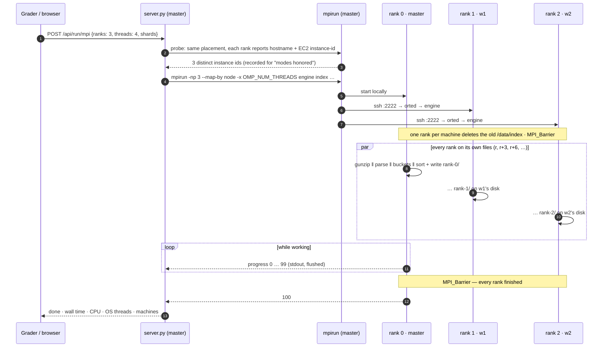

### 2.3 Inside the engine: one rank's index pipeline

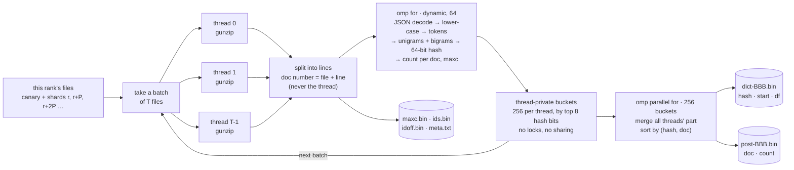

| Design choice | Problem it solves |
|---|---|
| features stored as **64-bit hashes** | ~70 M distinct word pairs as strings would need gigabytes |
| **256 buckets** by hash prefix | buckets are sorted and written in parallel; a query reads only its buckets |
| **thread-private** buckets | no locks and no shared writes while parsing |
| doc number from **file + line** | the index is byte-identical for any T, so results cannot depend on threads |
| **MPI only under mpirun** | `MPI_Init` adds 2 helper threads; skipping it keeps sequential at exactly 1 OS thread |

### 2.4 Search: a few numbers cross the network, never the dictionary

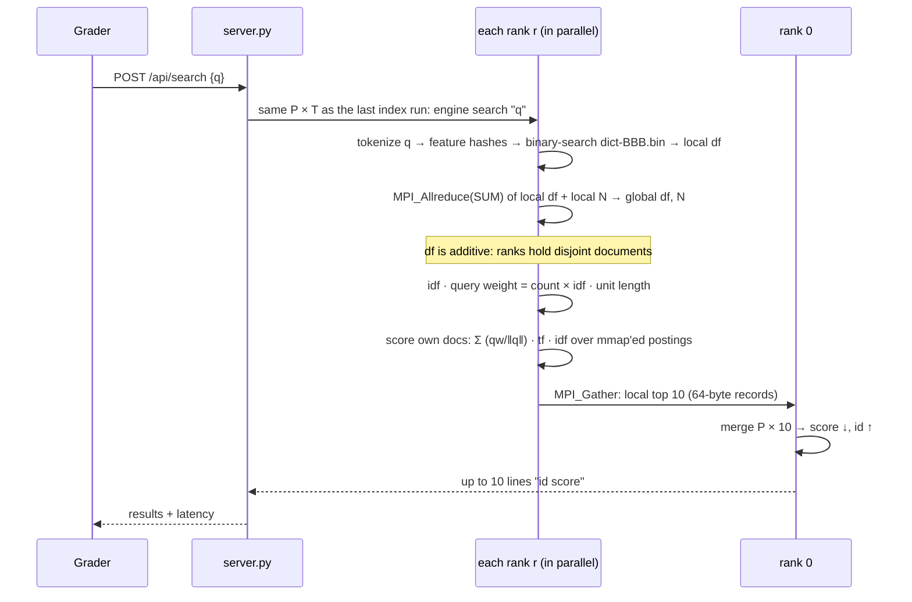

**Index files per rank** (`/data/index/rank-R/`): `meta.txt` (doc count, rank count), `maxc.bin` (4 B/doc),
`idoff.bin` + `ids.bin` (doc ids), `dict-000…255.bin` (`{u64 hash, u32 start, u32 df}`, 16 B/feature),
`post-000…255.bin` (`{u32 doc, u16 count}`, 6 B/posting).

---

## 3. The maths in 60 seconds

1. lower-case; a **token** is a maximal run of `[a-z0-9]`
2. drop tokens shorter than `min_token_len`, then stop-words; optional `plural_s` stemming
3. **features** = remaining tokens + consecutive pairs `a_b` — made *after* step 2, so "graph **of** nodes" → `graph_nodes`
4. weight = **tf × idf**, then the norm step

| tf | | idf | | norm | |
|---|---|---|---|---|---|
| raw | `c` | plain | `ln(N/df)` | l2 | divide by vector length |
| log | `1 + ln c` | smooth | `ln((1+N)/(1+df)) + 1` | none | — |
| aug | `0.5 + 0.5·c/maxc` | bm25 | `ln(1 + (N−df+0.5)/(df+0.5))` | | |

Query: same features, **weight = count × idf**, unknown features ignored, normalised to length 1.
`score = dot(query, doc)`; top 10 by score descending, ties by id ascending, only scores > 0.

<details><summary><b>7 traps that silently cost marks</b></summary>

1. The text is JSON — decode `\n`, `\"`, `é` with a real parser, or `\nGraph` becomes the token `ngraph`.
2. Bigrams are formed **after** removing stop-words and short tokens.
3. Query weights use the raw **count**, not tf; the query is L2-normalised even if documents are not.
4. Ties: id ascending, plain string compare. Print ≥ 10 significant digits (tolerance 1e-6 relative).
5. stdout is parsed: `index` prints only `0…100` (never decreasing, flushed, ends with 100); `search` only `id score`.
6. The 2,000 canary documents are part of **every** run and count in N.
7. Python's `str.lower()` maps `İ` (U+0130) → `i` and the Kelvin sign `K` (U+212A) → `k`; a Python grader tokenises those.
</details>

## 4. Repository layout

| Path | What it is |
|---|---|
| `engine/engine.cpp` | the engine; `[OpenMP]` and `[MPI]` sections are marked |
| `engine/json.hpp` | [nlohmann/json](https://github.com/nlohmann/json) v3.11.3 (MIT) |
| `ref.py` | Python answer key — a direct copy of the PDF formulas |
| `check.py`, `api_check.py` | engine vs answer key: directly, and through the web API like the grader |
| `bench.sh`, `bench_api.py`, `make_charts.py` | laptop timings, cluster benchmark sweep, chart generator |
| `results/`, `Images/` | raw measurements; charts and screenshots |
| `Dockerfile`, `entrypoint.sh`, `Dockerfile.dev` | node image; laptop dev image |
| `local-cluster/`, `deploy/` | 3-container laptop rehearsal; EC2 compose files and node scripts |
| *(git-ignored)* `server.py`, `config.json`, `settings.txt`, `canary.jsonl` | your kit — put them in the repo root |

---

## 5. Step-by-step guide

You need Docker Desktop, AWS CLI v2, Python 3 (+ `matplotlib` for charts), a Docker Hub account and an AWS account.
Steps 0–5 are free on the laptop; from Step 6, 3 × m5.xlarge cost ≈ US$0.58/h (*stop*, never terminate, between
sessions). Put your kit in the repo root and never edit it — the grader checks its sha256.
Commands are Windows PowerShell from the repo root.

### Step 0 — Look at the data
```powershell
mkdir data\shards; copy config.json, settings.txt, canary.jsonl data\
aws s3 cp --no-sign-request s3://arxiv-shards/shard-000.jsonl.gz data\shards\    # your first shards
aws s3 cp --no-sign-request s3://arxiv-shards/shard-001.jsonl.gz data\shards\
python -c "import gzip; f=gzip.open('data/shards/shard-000.jsonl.gz','rt',encoding='utf-8'); print('docs:', sum(1 for _ in f))"
```
**Expect** ≈ 12,500 docs per shard, each line `{"id": "…", "text": "Title. Abstract …"}`. `data\` mirrors `/data` on the servers.

### Step 1 — A Python answer key
```powershell
python ref.py selftest
python ref.py --data data search "graph neural network" "zq5109237" "the of and" "qwertyzzz" --shards 0
```
**Expect** `selftest OK` (the PDF's worked example: 0.5242, 0.2277, 0.1195, 0.1195); results for the first two queries,
none for the stop-word and unknown-word queries. Canary words give exact ties — a free test of the id tie-break.

### Step 2 — The C++ engine
```powershell
curl.exe -L -o engine\json.hpp https://github.com/nlohmann/json/releases/download/v3.11.3/json.hpp
docker build -t pdc-dev -f Dockerfile.dev .
docker run --rm -v "${PWD}:/work" pdc-dev bash -c "cd engine && mpicxx -O3 -fopenmp -std=c++17 -Wall engine.cpp -o engine -lz"
docker run --rm -v "${PWD}:/work" -v "${PWD}\data:/data" pdc-dev python3 check.py --shards 0 1
```
**Expect** 18 × `OK` and `ALL OK`. Read `engine.cpp` in order: `load_settings()` → `tokenize()`/`features()` →
`cmd_index()` → `cmd_search()` (pipeline in [2.3](#23-inside-the-engine-one-ranks-index-pipeline)).
The engine supports `norm=none`; `norm=l2` would need every feature's global df at index time and stops with a message.

### Step 3 — OpenMP
```powershell
docker run --rm -u root -v "${PWD}:/work" -v "${PWD}\data:/src:ro" pdc-dev bash /work/bench.sh 0 1 2
docker run --rm -v "${PWD}:/work" -v "${PWD}\data:/data" pdc-dev python3 check.py --shards 0 1 --threads 4
```
**Expect** faster runs with more threads and `ALL OK`. The four `[OpenMP]` spots: T files gunzipped at once, documents
shared with `schedule(dynamic, 64)`, lock-free thread-private buckets, buckets sorted in parallel.

### Step 4 — MPI
```powershell
docker run --rm -v "${PWD}:/work" -v "${PWD}\data:/data" pdc-dev bash -c "python3 check.py --shards 0 1 2 --threads 2 --launch 'mpirun -np 3 --oversubscribe -x OMP_NUM_THREADS'"
docker run --rm -v "${PWD}:/work" -v "${PWD}\data:/data" pdc-dev bash -c "python3 check.py --shards 0 1 --threads 1 --launch 'mpirun -np 6 --oversubscribe -x OMP_NUM_THREADS'"
```
**Expect** `ALL OK` twice (the second has more ranks than files). The `[MPI]` spots: files round-robin over ranks,
one index delete per machine (`MPI_Comm_split_type` + barrier), `MPI_Allreduce` of df, `MPI_Gather` of top-10s.

### Step 5 — Docker image + 3-node rehearsal on the laptop
```powershell
docker build -t pdc-scholar .
cd local-cluster; docker compose up -d; cd ..
docker exec -u mpiuser lc-master ssh 10.5.0.12 hostname       # lc-w1, no password prompt
python api_check.py --url http://localhost:8000 --shards 0 1 2 --threads 4 --ranks 3
cd local-cluster; docker compose down -v; cd ..
```
**Expect** threads 1 / 4 / 6, ranks on 3 hosts, `search: 18/18 OK` in every mode, `ALL OK`.

<details><summary>Why the image is built the way it is</summary>

| Decision | Why |
|---|---|
| ssh client config in `/etc/ssh/ssh_config.d/` | `~/.ssh` is the mounted key folder and would hide anything baked there |
| mpiuser password `*` | no password can match, but key login works (a locked `!` account is refused) |
| `--mca btl_tcp_if_include <VPC CIDR>` | host networking also exposes `docker0`; OpenMPI may try it and hang |
| `--bind-to none` | with ≤ 2 ranks OpenMPI pins each rank to one core |
| mpiuser uid 1000 | same owner as EC2's `ubuntu` user for mounted files |
| `.dockerignore` excludes `*.pem`, `mpi-ssh` | no private key can end up in the image |
</details>

### Step 6 — AWS
1. **Push:** `docker login`, `docker tag pdc-scholar <dockeruser>/pdc-scholar:1.0`, `docker push …`; copy the
   `sha256:` digest (`docker images --digests`) into both `deploy/*/docker-compose.yml`.
2. **Security group** `PDC-<roll>-sg`: SSH 22 from My IP · TCP 8000 from `54.196.248.239/32` and My IP · All traffic
   from the group itself. Never open 22 or 2222 to the world.
3. **3 instances**, one launch: Ubuntu LTS x86, **m5.xlarge**, one subnet, 50 GiB gp3, that group; name them
   `PDC-<roll>-master`, `-w1`, `-w2`. ⚠️ Free-plan accounts only offer 2-vCPU types — upgrade to the paid plan first
   (credits stay); an existing instance can be stopped and switched with *Change instance type*.
4. **Elastic IP** on the master — the address you submit.
5. **Prepare the nodes:**
```powershell
icacls key1.pem /inheritance:r /grant:r "$($env:USERNAME):(R)"
$M="<master EIP>"; $W1="<w1 public IP>"; $W2="<w2 public IP>"
mkdir mpi-ssh; ssh-keygen -t ed25519 -N '""' -C mpiuser -f mpi-ssh\id_ed25519
copy mpi-ssh\id_ed25519.pub mpi-ssh\authorized_keys
foreach ($ip in $M, $W1, $W2) {
  scp -i key1.pem config.json settings.txt canary.jsonl deploy\setup-node.sh deploy\check-node.sh "ubuntu@${ip}:~/"
  scp -i key1.pem -r mpi-ssh "ubuntu@${ip}:~/"
  ssh -i key1.pem "ubuntu@$ip" "bash setup-node.sh"
}
scp -i key1.pem deploy\master\docker-compose.yml "ubuntu@${M}:~/scholar/"
foreach ($ip in $W1, $W2) { scp -i key1.pem deploy\worker\docker-compose.yml "ubuntu@${ip}:~/scholar/" }
ssh -i key1.pem "ubuntu@$M" "printf '<master private> slots=4\n<w1 private> slots=4\n<w2 private> slots=4\n' > /data/hosts"
foreach ($ip in $M, $W1, $W2) { ssh -i key1.pem "ubuntu@$ip" "bash check-node.sh" }
```
**Expect** `NODE READY` per node and only `[OK]` lines from `check-node.sh` (4 vCPUs, `shards 200/200`, keys, ROLE, hosts).

### Step 7 — Start the cluster and test it like the grader
```powershell
foreach ($ip in $W1, $W2, $M) { ssh -i key1.pem "ubuntu@$ip" "cd scholar && docker compose up -d && docker ps" }
ssh -i key1.pem "ubuntu@$M" "docker exec -u mpiuser scholar ssh <w1 private> hostname"
curl.exe -s "http://${M}:8000/api/info"
python api_check.py --url "http://${M}:8000" --shards 0 1 2 --threads 4 --ranks 3
```
**Expect** `m5.xlarge`, 4 vCPUs, `shards_present` 200, `server_sha256` = `Get-FileHash server.py`; threads 1 / 4 / 6,
3 distinct instance ids, `ALL OK`.

### Step 8 — Final checks and submit
1. Run size **L** in all three modes in the browser; watch memory with
   ``ssh -i key1.pem "ubuntu@$M" "for i in `$(seq 48); do free -m | grep Mem; sleep 10; done"``.
2. Try other layouts (6×2, 2×4, 1×4) — a canary query must return identical results in each.
3. **Restart test:** stop all 3 instances, start them, wait 2 minutes — the page must come back by itself.
4. **Submit** the master Elastic IP and port 8000. Keep the instances running and don't benchmark until grading ends.

---

## 6. Reproduce the benchmarks

Only when the grader is **not** using the cluster (≈ 12 minutes; every run replaces the index).
```powershell
scp -i key1.pem deploy\memlog.sh "ubuntu@${M}:~/"
ssh -i key1.pem "ubuntu@$M" "setsid nohup bash memlog.sh 1500 > mem.log 2>&1 < /dev/null &"
python bench_api.py --url "http://${M}:8000"                                   # -> results/bench.json
mkdir results\logs; scp -i key1.pem "ubuntu@${M}:/data/logs/*.err" results\logs\
scp -i key1.pem "ubuntu@${M}:~/mem.log" results\mem.log
python make_charts.py                                                           # -> Images/charts/
```

## 7. Troubleshooting

| Symptom | Fix |
|---|---|
| `UNPROTECTED PRIVATE KEY FILE` | `icacls key1.pem /inheritance:r /grant:r "$($env:USERNAME):(R)"` |
| Quotes vanish in inline `ssh` commands | PowerShell 5.1 strips inner `"` — put the logic in a script (`deploy/*.sh`) |
| "UTF-8 BOM" errors on piped JSON | PowerShell 5.1 adds a BOM when piping; use Git Bash or `curl.exe -o file` |
| Only 2-vCPU instance types offered | AWS free plan → upgrade to the paid plan |
| mpirun hangs | `MPIRUN_ARGS` subnet ≠ VPC CIDR, or the security group lacks "All traffic from itself" |
| Cluster with 1–2 ranks slower than OpenMP | add `--bind-to none` to `MPIRUN_ARGS` |
| `Permission denied (publickey)` | `~/mpi-ssh` lacks `authorized_keys`, or the key has a passphrase |
| `index was built with X ranks` | search reuses the last index run's layout — index again first |

## 8. Grading checklist

| Marks | Checked | Measured here |
|---|---|---|
| 6 correctness | top-10 ids + scores, all modes, hidden / pair / canary / stop-word / unknown queries | 18/18 queries OK in every mode; 39 runs identical |
| 1 modes honored | OS threads; ranks on 3 distinct instances | threads 1 / 4 / 4 + 2 MPI; 3 instance ids |
| 1 timing integrity | real CPU work, live progress, repeatable, grows with size | CPU ≈ wall × threads; ± 3 %; linear in size |
| 2 scalability | speedup of OpenMP and cluster over sequential | **2.7×** and **8.3×** at 200 shards |

<sub>Secrets (`*.pem`, `mpi-ssh/`), the private kit and the instructor's files are git-ignored. `engine/json.hpp` is nlohmann/json (MIT).</sub>
